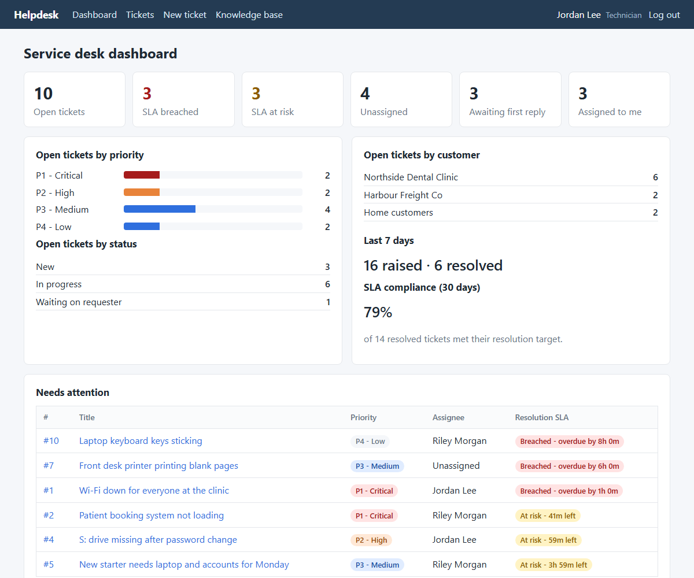
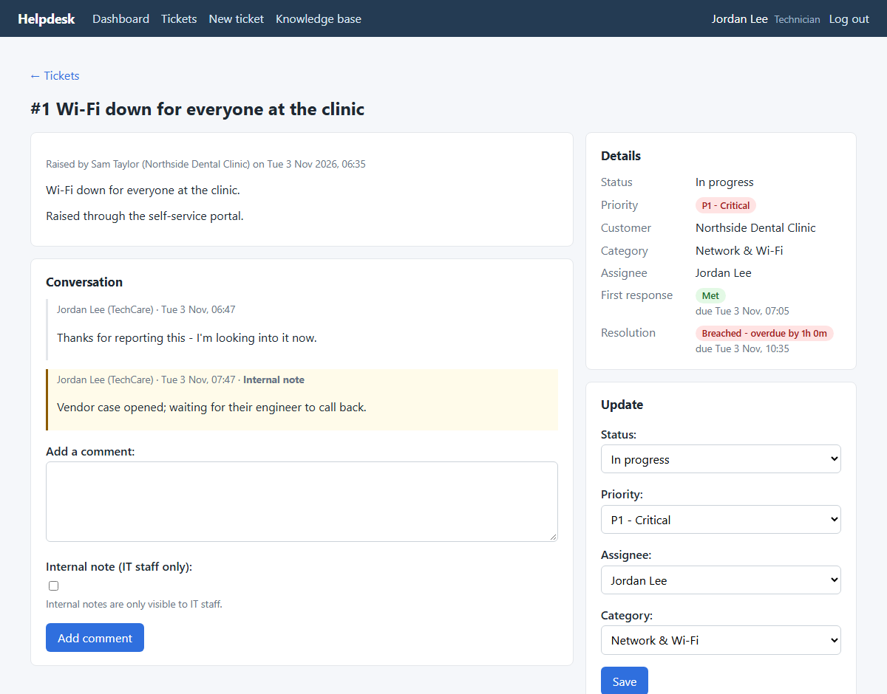
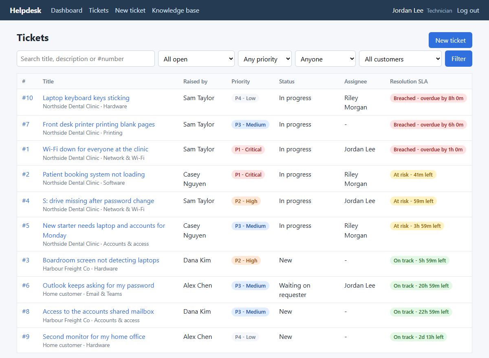
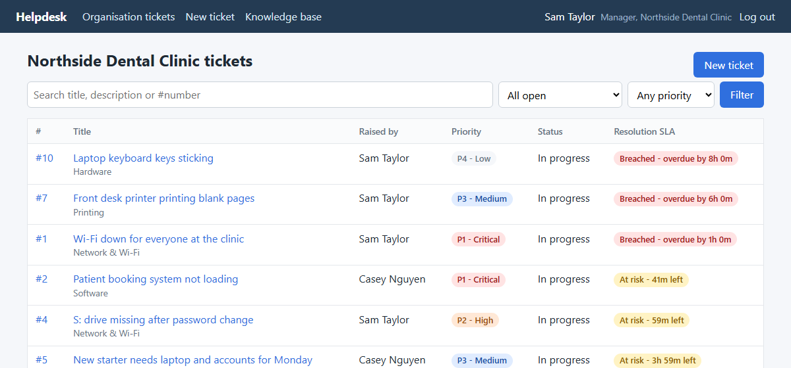
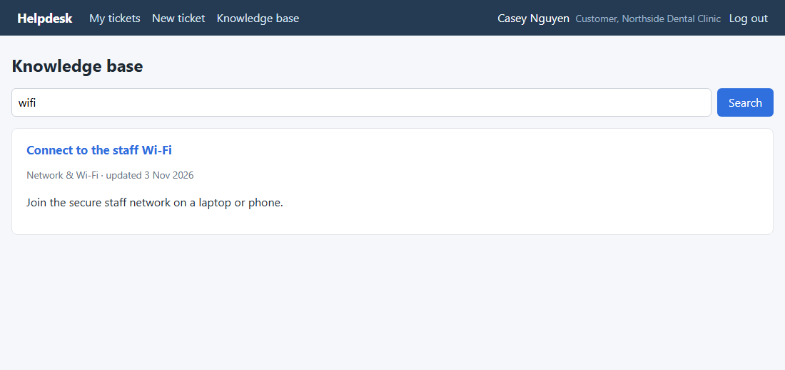

# Helpdesk Ticket Tracker

[](https://github.com/ManojFam/helpdesk-ticket-tracker/actions/workflows/ci.yml)

The customer portal of **TechCare Services**, a fictional IT company, built with Django.
Business customers and home customers raise tickets, technicians work them against **SLA
timers**, a **knowledge base** helps people fix common problems themselves, and a
**dashboard** shows what needs attention right now.



**New to the code?** Read **[the guide](docs/GUIDE.md)**. It covers how the app works file by
file, the data model, the SLA rules, permissions, a demo script and interview talking points.

## Features

- **Tickets** have a priority (P1 to P4), a status (New, In progress, Waiting on requester,
  Resolved, Closed), a category and an assignee. The conversation thread supports
  **internal notes** that only TechCare staff can see.
- **Two SLA timers per ticket**, first response and resolution, each shown as *On track*,
  *At risk* (last 25% of the time), *Breached* or *Met*, with the time left:

  | Priority | First response | Resolution |
  |---|---|---|
  | P1 - Critical | 30 min | 4 h |
  | P2 - High | 1 h | 8 h |
  | P3 - Medium | 4 h | 24 h |
  | P4 - Low | 8 h | 72 h |

- **Dashboard** for TechCare staff: open, breached, at-risk and unassigned counts, tickets
  awaiting a first reply, open tickets by priority and status, 30-day SLA compliance, and a
  *Needs attention* list sorted by deadline.
- **Ticket list** with search (including `#123`), filters for status, priority and
  assignee, and pagination. It is sorted so the nearest deadline comes first.
- **Knowledge base** with search. The *New ticket* page suggests articles, and tickets show
  related articles from their category.
- **Four roles, one website.** *Customers* see only their own tickets. *Organisation
  managers* at a business customer also see every ticket from their organisation.
  *Technicians* see and work every ticket. *Admins* also manage organisations, users and
  articles in the Django admin.
- **Business and home customers.** Each business customer is an *organisation*. Tickets
  record their organisation, staff can filter by customer, and the dashboard shows open
  tickets per customer.

| Ticket (technician view) | All tickets (technician view) |
|---|---|
|  |  |

An organisation manager sees their whole organisation's tickets, and nobody else's:



Knowledge base search, as a customer sees it:



## Run it locally

Needs Python 3.12 or newer.

```bash
git clone https://github.com/ManojFam/helpdesk-ticket-tracker.git
cd helpdesk-ticket-tracker
python -m venv .venv
# Windows: .venv\Scripts\activate    Linux/macOS: source .venv/bin/activate
pip install -r requirements.txt

cp .env.example .env          # Windows: copy .env.example .env
# edit .env and set DJANGO_SECRET_KEY (the file shows how to generate one)

python manage.py migrate
python manage.py seed_demo    # fictional demo data; prints the demo password
python manage.py runserver
```

Open http://127.0.0.1:8000 and log in as:

- `jordan.lee`, technician (dashboard, all tickets)
- `sam.taylor`, manager at Northside Dental Clinic (all of Northside's tickets)
- `casey.nguyen`, staff at Northside Dental Clinic (only Casey's own tickets)
- `alex.chen`, home customer
- `helpdesk.admin`, admin (also has the Django admin at `/admin/`)

`seed_demo` generates a random password and prints it once. Pass `--password` to choose one,
or `--reset` to replace existing demo data. All demo people, emails (`@example.com`) and
tickets are made up.

## How it is built

```text
config/              settings (read from environment / .env), URLs, WSGI
helpdesk/
  sla.py             SLA targets and the on-track / at-risk / breached / met rules
  roles.py           admin / technician / organisation manager / customer, in one place
  models.py          Organisation, Profile, Category, Ticket, Comment, Article
  signals.py         creates a profile for every new user
  views.py           dashboard, ticket list/detail/create, comments, updates, knowledge base
  forms.py           ticket, update and comment forms
  permissions.py     staff_required decorator
  templatetags/      SLA and priority badges, display names
  templates/         plain Django templates, one small CSS file, no JavaScript
  management/commands/seed_demo.py
  tests/             Django TestCase suite
```

Design choices:

- **SLA rules live in one plain-Python module** (`sla.py`) with no database code, so the
  rules are easy to read and are unit-tested on their own. The model calls them. Changing
  a target is a one-line edit.
- **Due dates are stored on the ticket** (`response_due_at` and `resolution_due_at`, set in
  `Ticket.save()`). That makes "breached" a simple database query, and sorting the list by
  urgency is just `ORDER BY resolution_due_at`. Changing the priority moves the deadlines,
  counted from when the ticket was raised (not from the change), so they can't be reset
  by bumping the priority.
- **Response time is measured from the first public reply by IT.** Internal notes, the
  requester's own comments and TechCare staff commenting on their own tickets don't stop the clock.
  Resolving records `resolved_at`, and reopening clears it.
- **Access is checked on the queryset, not only in templates.** `Ticket.objects.visible_to(user)`
  is used for viewing *and* commenting: everything for staff, the organisation's tickets for
  its manager, and only their own for everyone else. Asking for a ticket you may not see gives
  a 404, which doesn't reveal that the ticket exists, so one customer can't learn anything
  about another. Updating a ticket needs `staff_required`,
  and a logged-in non-staff user gets 403 instead of looping back to the login page.
  Requesters can't set the requester, the status or the internal-note flag, because those
  fields are left out of their forms.
- **Small touches that save IT time.** A requester replying to a "Waiting on requester"
  ticket puts it back to *In progress*. Knowledge-base search ignores hyphens, so `wifi`
  finds "Wi-Fi".
- **Organisations through a `Profile` table, not a custom user model.** Extending Django's
  user one-to-one is the safe way to add fields to an existing project. A signal creates the
  profile for every new user, and a data migration covered existing users. Tickets keep the
  organisation they were raised under, even if the person later moves on.
- **Configuration comes from environment variables.** `SECRET_KEY` is required, `DEBUG`
  defaults to off, and `.env` is never committed (see `.env.example`).

Not included (possible next steps): business-hours SLA calendars, pausing the clock while
waiting on the requester, email notifications, and file attachments.

## Tests

```bash
python manage.py test
ruff check . && ruff format --check .
```

There are 66 tests. They cover every SLA rule and boundary, due dates and priority changes,
first-response rules, what each of the four roles can see, comment on or update (including
one customer never seeing another's tickets), internal-note privacy,
ticket list filters and ordering, dashboard counts and compliance, knowledge-base search and
drafts, and the demo seed command. Test runs use a fast password hasher so the suite takes
under a second. GitHub Actions runs `manage.py check`, a missing-migrations check, ruff and the
tests on every push.

## License

[MIT](LICENSE)
