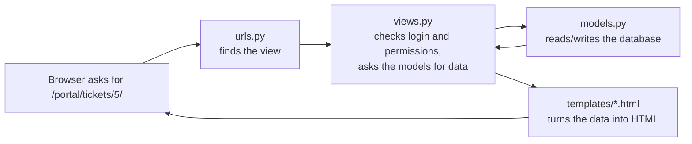
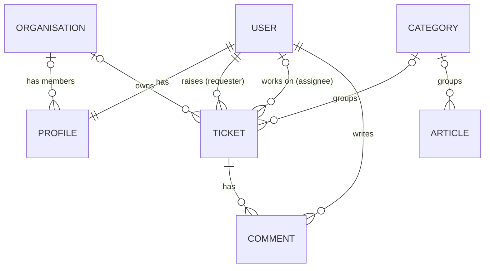

# Helpdesk Ticket Tracker: the guide

This guide explains how the app works, in plain English, for anyone who wants to
understand the code: a new developer, an interviewer, or you before an interview. Read it
top to bottom once, then use it as a reference.

**Contents**

1. [What the app is](#1-what-the-app-is)
2. [Try it in 5 minutes](#2-try-it-in-5-minutes)
3. [How a Django app fits together](#3-how-a-django-app-fits-together)
4. [Tour of the files](#4-tour-of-the-files)
5. [The data: tables and how they link](#5-the-data-tables-and-how-they-link)
6. [How the SLA timers work](#6-how-the-sla-timers-work)
7. [Who can do what](#7-who-can-do-what)
8. [Life of a ticket, step by step](#8-life-of-a-ticket-step-by-step)
9. [The dashboard numbers](#9-the-dashboard-numbers)
10. [Tests and CI](#10-tests-and-ci)
11. [Settings, secrets and security](#11-settings-secrets-and-security)
12. [Common jobs](#12-common-jobs)
13. [Interview talking points](#13-interview-talking-points)
14. [Glossary](#14-glossary)
15. [Roadmap: TechCare Services](#15-roadmap-techcare-services)
16. [How each feature was built](#16-how-each-feature-was-built)

---

## 1. What the app is

A service desk web app. People who need IT help **raise tickets**. The IT team **works the
tickets** against time targets (**SLAs**), writes **knowledge-base articles** so people can
fix common problems themselves, and watches a **dashboard** that shows what is late or about
to be late.

It belongs to **TechCare Services**, a fictional IT company that supports **business
customers** (organisations) and **home customers**. There are two parts:

- **The public website** (`/` and `/services/`). Anyone can visit it without logging in. It
  explains what TechCare does, lists services and prices, and shows the response times.
- **The portal** (everything under `/portal/`). Customers and staff log in here. It's one
  portal for everyone, and what you see depends on your **role**:

| Role | Who | What they see |
|---|---|---|
| **Customer** | Someone at a business customer (account created by TechCare), or a home customer (signed up themselves, with email or Google) | Their own tickets, a "New ticket" form and the knowledge base |
| **Organisation manager** | A customer marked as manager of their organisation | Everything a customer sees, plus **every ticket raised by people in their organisation** |
| **Technician** | TechCare staff (`is_staff` ticked) | The dashboard, every ticket, the update panel (status, priority, assignee) and internal notes |
| **Admin** | TechCare staff who are also superusers | All of the above, plus the Django admin at `/admin/` (organisations, users, articles) |

[Section 15](#15-roadmap-techcare-services) lists the features still to come, and
[section 16](#16-how-each-feature-was-built) explains how each finished feature was built.

## 2. Try it in 5 minutes

Set it up once (the README has the same steps):

```bash
cd helpdesk-ticket-tracker
python -m venv .venv
.venv\Scripts\activate              # macOS/Linux: source .venv/bin/activate
pip install -r requirements.txt
copy .env.example .env              # then put a secret key in .env
python manage.py migrate
python manage.py seed_demo          # prints the demo password
python manage.py runserver
```

Open http://127.0.0.1:8000. That's the **public website**. Look around: *Services &
prices*, *How it works* and *Response times*.

**Sign up as a new home customer:** click **Create account**, fill in a made-up name, an
address like `you@example.com` and a password. The page says a verification email was sent.
Look in the terminal running `runserver`: the email is printed there, with a
`/accounts/confirm-email/...` link. Open the link and click **Confirm**. You're logged in, on
*My tickets*, as a customer with no organisation.

Then log out, click **Log in** and follow this script:

The demo has these people (all fictional):

| Username | Role |
|---|---|
| `jordan.lee`, `riley.morgan` | Technicians |
| `helpdesk.admin` | Admin |
| `sam.taylor` | Manager at **Northside Dental Clinic** |
| `casey.nguyen` | Staff member at **Northside Dental Clinic** |
| `dana.kim` | Manager at **Harbour Freight Co** |
| `alex.chen` | Home customer |

1. **Log in as `jordan.lee`** (technician). You land on the **dashboard**. Look at
   *SLA breached*, *SLA at risk*, *Open tickets by customer* and the *Needs attention* list.
2. Click **Wi-Fi down for everyone at the clinic**. On the right, *First response* is
   **Met** (Jordan replied quickly) but *Resolution* is **Breached** (P1 tickets have 4
   hours). The yellow comment is an **internal note**.
3. In **Update**, set *Status* to **Resolved** and click *Save*. The resolution badge now
   says *Breached* without "overdue by": the clock has stopped, too late.
4. Go to **Tickets**. Under each title you can see the customer. Try the filters:
   *Unassigned*, *P1 - Critical*, *Harbour Freight Co*, *Home customers*, or search `#3`.
5. **Log out and log in as `sam.taylor`** (manager at Northside). The menu says
   *Organisation tickets*. You see Sam's tickets **and Casey's**, with a *Raised by*
   column, but nothing from Harbour Freight. Open Casey's ticket: there is no internal note.
6. **Log in as `casey.nguyen`** (staff at Northside). Casey sees only Casey's own tickets.
   Try opening one of Sam's, e.g. `/portal/tickets/1/`. You get *Not Found*.
7. As Casey, click **New ticket**. The page suggests knowledge-base articles. Raise a
   ticket, then log back in as Sam: the new ticket shows up in Sam's list too.
8. Open **Knowledge base** and search `wifi`. It finds the "Wi-Fi" article (hyphens are
   ignored).
9. **Log in as `helpdesk.admin`** and open **Admin**, then *Organisations*, then
   *Northside Dental Clinic*. You see its members and who the manager is.
10. Still in Admin, open **Services**. Change a price in the list, click *Save*, then click
    **TechCare Services** in the portal header to go back to the website. The new price is
    already there.

**Technician visits:**

11. **Log in as `alex.chen`** (home customer) and open **Visits**: Alex has a *Requested*
    Wi-Fi visit, a *Completed* clean-up and nothing else. Click **Book a visit**. The service
    list only shows on-site services for homes. Try today's date (refused), a Sunday (refused),
    then a weekday next week. You land on the visit, and a ticket was created with it.
12. **Log in as `jordan.lee`.** The dashboard shows *Visits to confirm*. Open Alex's visit,
    choose a technician and a slot, and click **Confirm visit**. Open the visit's ticket: a
    public comment says when and who, and the first-response clock has stopped.
13. Try confirming another visit for the **same technician, day and slot**: it's refused
    ("already has a visit in that slot").
14. Open **My schedule**: Jordan's confirmed visits for the next two weeks, with address,
    phone and access notes. Pick another technician from the list to see theirs.
15. On a confirmed visit, click **Mark as completed**: the visit is completed and its ticket
    resolved.

## 3. How a Django app fits together

Django splits a web app into a few kinds of file. Every page in this app goes through the
same path:



| Piece | Job | In this project |
|---|---|---|
| **Settings** | Configuration: database, installed apps, time zone, secret key | `config/settings.py` |
| **URLs** | Map an address to a view | `config/urls.py`, `helpdesk/urls.py`, `website/urls.py` |
| **Views** | Python functions that handle a request and return a page | `helpdesk/views.py` |
| **Models** | Python classes that describe database tables | `helpdesk/models.py` |
| **Migrations** | Files that create or change the tables to match the models | `helpdesk/migrations/` |
| **Forms** | Turn a model into an HTML form and validate what users type | `helpdesk/forms.py` |
| **Templates** | HTML with `{{ placeholders }}` and `` | `helpdesk/templates/` |
| **Admin** | A ready-made back office for editing data | `helpdesk/admin.py` |
| **Management commands** | Your own `python manage.py ...` commands | `helpdesk/management/commands/` |

`config` is the **project** (site-wide settings). `helpdesk` and `website` are **apps**
(feature areas). `helpdesk` is the portal and holds all the data. `website` is the public
shop window: it has no tables of its own and only displays services and SLA promises that
live in `helpdesk`.

## 4. Tour of the files

```text
manage.py                 runs Django commands (runserver, migrate, test, seed_demo)
requirements.txt          Python packages to install (Django, python-dotenv)
.env.example              template for your private .env file
pyproject.toml            settings for ruff, the code checker
config/
  settings.py             reads .env; apps, database, time zone, login pages
  urls.py                 /admin/, /accounts/ (login/logout), /portal/ -> helpdesk, / -> website
  wsgi.py                 entry point for a production web server
helpdesk/
  sla.py                  the SLA rules (no database code at all)
  roles.py                who is admin / technician / organisation manager / customer
  models.py               Organisation, Profile, Service, Category, Ticket, Comment, Article
  signals.py              creates a Profile whenever a user is created
  views.py                one function per page (tickets, dashboard, knowledge base)
  bookings.py             the rules for visits: dates, services, double-booking, status changes
  booking_views.py        the visit pages (request, list, detail, confirm, complete, cancel, schedule)
  urls.py                 the addresses of those pages
  forms.py                new ticket, update ticket, add comment, sign-up extra fields
  accounts.py             trust_email() for TechCare-created accounts, display_name()
  permissions.py          @staff_required
  admin.py                how the models appear in /admin/ (users with their profile)
  templatetags/
    helpdesk_tags.py      , , |person, |role_label
  templates/
    base.html             header and menu shared by every page
    account/              our versions of allauth's pages: login.html, signup.html,
                          _google_button.html, email/ (the verification email text)
    allauth/layouts/base.html   makes allauth's other pages use base.html
    helpdesk/*.html       dashboard, ticket list/detail/form, knowledge base,
                          booking_list/form/detail, schedule
  static/helpdesk/style.css   the only stylesheet
  management/commands/seed_demo.py   fills the database with demo data
  migrations/
    0001_initial.py                  creates the first tables
    0002_organisations_and_profiles.py   adds Organisation, Profile, Ticket.organisation
    0003_create_missing_profiles.py      gives users who already existed a profile
    0004_services.py                     adds the Service price list
    0005_bookings.py                     adds Booking and its double-booking constraint
  tests/                  automatic tests (section 10)
website/                  the public TechCare website (no models)
  views.py                home page and services page
  urls.py                 / and /services/
  templates/website/      base.html (public header/footer), home.html, services.html,
                          _service_card.html, _response_times.html (shared pieces)
  static/website/site.css the website's own stylesheet
  tests.py                tests for the public pages
.github/workflows/ci.yml  GitHub runs the checks on every push
docs/                     this guide and the screenshots
```

### The files worth reading first

1. **`helpdesk/sla.py`** and **`helpdesk/roles.py`** are short and hold the business rules,
   so they're the easiest files to start with.
2. **`helpdesk/models.py`**, especially `TicketQuerySet.visible_to()`, `Ticket.save()` and
   `Ticket.add_comment()`.
3. **`helpdesk/views.py`**, especially `ticket_detail` and `ticket_comment`. They show how
   permissions are enforced.
4. **`helpdesk/templates/helpdesk/ticket_detail.html`**, to see how the data reaches the page.

## 5. The data: tables and how they link



**User** is Django's built-in user table. `is_staff` means "works at TechCare"
(technician), and `is_staff` plus `is_superuser` means admin.

**Organisation** is a business customer: `name` (unique), `phone`, `address`, and
`is_active` (untick when they stop being a customer).

**Profile** holds the extra details for each user, one profile per user:

| Field | Meaning |
|---|---|
| `user` | The user it belongs to (one-to-one) |
| `organisation` | Which business customer they work for. Empty for home customers and TechCare staff |
| `is_org_manager` | Can see every ticket from their organisation. Only allowed when `organisation` is set (`Profile.clean()`) |
| `phone` | Contact number |

A profile is created automatically for every new user by `signals.py`, so code can always
use `user.profile`.

**Ticket** (the main table):

| Field | Meaning |
|---|---|
| `title`, `description` | What the problem is |
| `requester` | Who raised it. Can't be deleted while they have tickets (`PROTECT`) |
| `organisation` | The requester's organisation **at the time the ticket was raised** (set in `Ticket.save()`). Empty for home customers |
| `assignee` | TechCare technician working on it (optional). Only staff can be chosen |
| `category` | Hardware, Printing, ... (optional) |
| `priority` | 1 = P1 Critical, 2 = P2 High, 3 = P3 Medium, 4 = P4 Low |
| `status` | `new`, `in_progress`, `waiting`, `resolved`, `closed` |
| `created_at` | When it was raised. The SLA clocks start here |
| `response_due_at`, `resolution_due_at` | Deadlines, **calculated automatically** (section 6) |
| `first_response_at` | When IT first replied publicly |
| `resolved_at` | When it was resolved. Cleared again if the ticket is reopened |

**Comment** belongs to one ticket. `is_internal = True` makes it an internal note that only
TechCare staff can see.

**Article** is a knowledge-base page. `is_published = False` keeps it as a hidden draft.
`slug` is the readable address part, e.g. `/portal/kb/reset-your-password/`.

**Category** is a simple list of names shared by tickets and articles.

**Service** is one line of TechCare's price list, shown on the public website:

| Field | Meaning |
|---|---|
| `name`, `slug` | e.g. "On-site repair visit", `on-site-repair-visit` |
| `summary` | One line for the home page cards |
| `description` | The longer text on the services page |
| `audience` | `business`, `home` or `both`. Decides which list it appears in |
| `delivery` | `onsite`, `remote` or `either` |
| `price_from`, `price_unit` | e.g. `129.00` and "per visit", shown as "From $129 per visit" (`price_label`) |
| `is_active` | Untick to hide it from the website without deleting it |
| `sort_order` | Lower numbers are shown first |

**Booking** is a request for a technician visit. Every booking belongs to exactly one ticket
(`OneToOneField`):

| Field | Meaning |
|---|---|
| `ticket` | The ticket created with it. The conversation and SLA timers live there |
| `service` | Which on-site service. Remote-only services can't be chosen |
| `address`, `contact_phone`, `notes` | Where to go, who to call, access notes ("parking at the rear") |
| `visit_date`, `time_slot` | The day, and `morning` (8am-12pm) or `afternoon` (12pm-5pm) |
| `status` | `requested`, `confirmed`, `completed` or `cancelled` |
| `technician` | The TechCare technician going (set when confirmed) |

A **database constraint** (`one_confirmed_visit_per_technician_slot`) makes it impossible
to store two *confirmed* visits for the same technician, day and slot.

`TicketQuerySet` in `models.py` adds two shortcuts used everywhere:

- `Ticket.objects.open()`: tickets that are New, In progress or Waiting
- `Ticket.objects.visible_to(user)`: every ticket for TechCare staff, the whole
  organisation's tickets (plus their own) for organisation managers, and only their own for
  everyone else

## 6. How the SLA timers work

An **SLA** (service level agreement) is a promise about how fast IT will act. Each ticket
has two timers, both starting when the ticket is raised:

| Priority | First response within | Resolution within |
|---|---|---|
| P1 - Critical | 30 minutes | 4 hours |
| P2 - High | 1 hour | 8 hours |
| P3 - Medium | 4 hours | 24 hours |
| P4 - Low | 8 hours | 72 hours |

These numbers live in `SLA_TARGETS` in `helpdesk/sla.py`. Change them there and the whole
app follows.

**The four states** (`sla.sla_state()`):

| State | Rule |
|---|---|
| **On track** | Still running, with more than 25% of the time left |
| **At risk** | Still running, with 25% or less left (`AT_RISK_SHARE = 0.25`) |
| **Breached** | Still running and past the deadline, *or* finished after the deadline |
| **Met** | Finished on or before the deadline |

**Worked example.** A P2 ticket is raised at 9:00, so resolution is due at 17:00 (8 hours).

- At 12:00 there are 5 of 8 hours left: **On track**.
- At 15:00 there are 2 hours left, exactly 25%: **At risk**.
- At 17:30 it is still open: **Breached** ("overdue by 30m").
- If it was resolved at 16:00 instead, it shows **Met**, and stays Met forever.

**When the clocks stop:**

- *First response* stops at the first **public** comment by **TechCare staff** on someone
  else's ticket. Internal notes don't count, and neither does the requester commenting on
  their own ticket. See `Ticket.add_comment()`.
- *Resolution* stops when the status becomes Resolved or Closed (`resolved_at` is set in
  `Ticket.save()`). Reopening the ticket clears `resolved_at`, so the clock runs again.

**Why store the deadlines?** `Ticket.save()` works out `response_due_at` and
`resolution_due_at` every time a ticket is saved. Because they are stored as columns:

- "Which tickets are late?" is a quick database query (`resolution_due_at < now`).
- The ticket list can sort by urgency with plain `ORDER BY resolution_due_at`.
- Changing the priority moves the deadlines. They are still counted from creation time,
  so raising and lowering the priority can't reset the clock.

**Simplifications** (on purpose, listed in the README): the clocks run 24/7 (no business
hours), and they don't pause while waiting on the requester.

## 7. Who can do what

| Action | Not logged in | Customer | Organisation manager | Technician / Admin |
|---|---|---|---|---|
| Public website (`/`, `/services/`) | yes | yes | yes | yes |
| See the dashboard | login page | **403 Forbidden** | **403** | yes |
| List tickets | login page | own only | own + organisation's, with *Raised by* | all, with customer filter |
| Open a ticket | login page | own only (**404** otherwise) | own + organisation's (**404** otherwise) | all |
| Raise a ticket | login page | yes | yes | yes |
| Comment | login page | own tickets | own + organisation's | all |
| Write or see internal notes | - | no | no | yes |
| Change status, priority or assignee | login page | **403** | **403** | yes |
| Knowledge base | login page | published articles | published articles | published articles |
| Book a visit | login page | yes, on-site services for their customer type | yes | yes, any on-site service |
| See visits | login page | own only | own + organisation's | all |
| Confirm, change or complete a visit | login page | **403** | **403** | yes |
| Cancel a visit | login page | own, until the day before | own + organisation's, until the day before | any open visit |
| My schedule | login page | **403** | **403** | yes |
| Django admin | login page | no | no | admin only |

Roles are worked out in **one function**, `roles.role_of(user)`. Templates use it through
the `|role` and `|role_label` filters, and the queryset uses it in `visible_to()`. Rules
like "a manager flag without an organisation gives no extra access" only need to be right in
one place.

**How it's enforced, and why it's done this way:**

- `@login_required` (from Django) sends anonymous users to the login page.
- `@staff_required` (in `permissions.py`) also sends anonymous users to login, but gives
  logged-in non-staff a **403**. Sending them to the login page would loop, because they
  are already logged in.
- **Data is filtered, not only hidden.** `ticket_detail` and `ticket_comment` both look the
  ticket up through `Ticket.objects.visible_to(request.user)`. Hiding a link in the template
  is not security, because anyone can type a URL. Filtering the database query is.
- **404 instead of 403 for other people's tickets.** A 403 would confirm that ticket #57
  exists. A 404 reveals nothing. That matters more now: one business customer must never
  learn anything about another's tickets.
- **Forms only include fields the user may set.** `TicketCreateForm` has no `requester` or
  `status` field, and the view sets `requester = request.user`. Even if someone adds
  `status=closed` to the request by hand, Django ignores it. There's a test for this
  (`test_requester_cannot_choose_the_requester_or_status`).
- Every form has a **CSRF token** (``). It stops other websites submitting
  forms in a logged-in user's name.

## 8. Life of a ticket, step by step

**1. Sam raises a ticket.** The browser posts the form to `/portal/tickets/new/`.

- `helpdesk/urls.py` maps that address to `views.ticket_create`.
- `@login_required` checks that Sam is logged in.
- `TicketCreateForm(request.POST)` validates the title, category, priority and description.
- `form.save(commit=False)` builds the ticket without saving it yet, so the view can set
  `ticket.requester = request.user`.
- `ticket.save()` runs **`Ticket.save()`** in `models.py`, which works out both deadlines
  from the priority.
- The view adds a "Ticket #25 raised" message and redirects to the ticket page.

**2. Jordan replies.** A post to `/portal/tickets/25/comment/` runs `views.ticket_comment`.

- The ticket is fetched with `visible_to(request.user)`. Jordan is staff, so it's found.
- `ticket.add_comment(...)` saves the comment. Because Jordan is staff, the comment is
  public and it's not Jordan's own ticket, it sets `first_response_at`. **The response
  clock stops.**

**3. Jordan asks Sam a question** and sets the status to *Waiting on requester* via
`/portal/tickets/25/update/` (`views.ticket_update`, staff only).

**4. Sam answers.** In `ticket_comment`, a requester replying to a *Waiting* ticket moves it
back to **In progress**, so it shows up in IT's queue again.

**5. Jordan resolves it.** In `Ticket.save()`, status *Resolved* sets `resolved_at = now`
and **the resolution clock stops**. The ticket now shows *Met* or *Breached*.

## 9. The dashboard numbers

All of these are worked out in `views.dashboard`:

| Number | How |
|---|---|
| Open tickets | `Ticket.objects.open()` |
| SLA breached / at risk | Each open ticket's `resolution_sla()` state |
| Unassigned | Open tickets with no `assignee` |
| Awaiting first reply | Open tickets with no `first_response_at` |
| Assigned to me | Open tickets where `assignee` is the logged-in user |
| Last 7 days | Tickets created, and tickets resolved, in the last 7 days |
| SLA compliance | Of tickets resolved in the last 30 days, the share resolved before `resolution_due_at`. Uses `F("resolution_due_at")` so the database compares two columns |
| Needs attention | Breached and at-risk tickets, nearest deadline first, top 10 |

The open tickets are loaded **once** and counted in Python. That's simple and fast for a
helpdesk with hundreds of open tickets. With tens of thousands, these counts would move into
database queries.

## 10. Tests and CI

Run all 122 tests:

```bash
python manage.py test
```

You should see `Ran 122 tests ... OK`. Each test creates its own empty test database, so
your real data is never touched.

| File | What it checks |
|---|---|
| `tests/test_sla.py` | Every SLA rule and boundary (exactly 25% left, exactly at the deadline, ...) and the "2h 15m left" text |
| `tests/test_models.py` | Deadlines on create and on priority change, resolved/reopened, first-response rules, `open()` and `visible_to()` |
| `tests/test_views.py` | Login redirects, 403/404 rules, raising/updating/commenting, internal-note privacy, list filters and order, dashboard counts, knowledge-base search |
| `tests/test_bookings.py` | Date rules (tomorrow to 60 days, no Sundays), which services each customer type can book, requesting a visit creates its ticket, visibility (404 for other customers, managers see colleagues'), customers can't confirm or complete, confirming assigns and comments, **no double-booking** (form and database), completing resolves the ticket, cancelling rules, the schedule, dashboard counts, the date shown in the format browsers need, and the website's *Book a visit* links |
| `tests/test_accounts.py` | Sign-up makes a home customer and sends a branded verification email, no login before confirming, confirming logs in, sign-up can't make staff or join an organisation, existing emails aren't revealed, weak passwords refused, login by username or email, logout, password reset, trusted emails for admin-created users, the Google button only when configured and that it redirects to Google |
| `tests/test_organisations.py` | Profiles are created automatically, the four roles, which tickets each role can see/open/comment on, managers still blocked from staff pages, staff filter by customer, dashboard per-customer counts, admin pages |
| `tests/test_seed_demo.py` | The demo data covers every SLA state, every customer type and the price list, the password option, and refusing to seed twice |
| `website/tests.py` | The public pages work without logging in, show only active services (at most 6 on the home page), group them for businesses and homes, show response times taken from `sla.py`, the "From $129 per visit" price format, and that login goes to the portal and logout back to the website |
| `tests/helpers.py` | Small functions the tests share (`make_user`, `make_ticket`) |

Run one file or one test while you work on something:

```bash
python manage.py test helpdesk.tests.test_sla
python manage.py test helpdesk.tests.test_views.AccessTests.test_requesters_cannot_open_the_dashboard
```

**Why the tests are fast:** Django's normal password hashing is slow on purpose (it makes
stolen password hashes hard to crack). `settings.py` switches to a fast hasher only while
tests run, which takes the suite from about 2 minutes to under 1 second.

**CI (continuous integration).** `.github/workflows/ci.yml` tells GitHub to do this on
every push:

1. Install Python 3.13 and the requirements.
2. `ruff check` and `ruff format --check`: code style and common mistakes.
3. `manage.py check`: Django's own configuration checks.
4. `makemigrations --check`: fails if someone changed a model but forgot the migration.
5. `manage.py test`: all the tests.

A green badge on the README means every step passed for the latest commit.

## 11. Settings, secrets and security

- **`.env` holds secrets** and is listed in `.gitignore`, so it's never committed.
  `.env.example` shows which variables exist, with no real values.
- **`DJANGO_SECRET_KEY` is required.** The app refuses to start without one, so you can't
  accidentally run with a published key. CI uses a throwaway key that only exists during the
  test run.
- **`DEBUG` is off unless you turn it on.** With debug on, error pages show internal details,
  so it should only be on for your own machine.
- **`TIME_ZONE`** (default Australia/Melbourne) sets how times are displayed. Times are
  stored in UTC (`USE_TZ = True`), so SLA maths is correct even across daylight saving
  changes.
- **Templates escape everything** by default. A ticket titled `<script>` shows as text and
  doesn't run.
- The **demo password** is generated randomly by `seed_demo` and never stored in the code.
- **Accounts are handled by django-allauth**, a widely used, maintained package, rather than
  home-made login code. It brings:
  - **email verification** before anyone can log in
  - **rate limits** on login attempts and emails (stored in Django's cache)
  - **enumeration protection:** the sign-up and password-reset pages never reveal whether an
    email address already has an account
  - Django's **password strength rules**
- **Google keys** (`GOOGLE_CLIENT_ID`, `GOOGLE_CLIENT_SECRET`) live in `.env`, like the secret
  key. See [GOOGLE_SIGN_IN.md](GOOGLE_SIGN_IN.md).
- **Emails** go to the terminal in development (`DJANGO_EMAIL_BACKEND` defaults to the
  console backend). A real deployment would set an SMTP backend in `.env`.

Before putting this on the internet you'd also want HTTPS, secure cookies, a real
database (PostgreSQL) and a production web server. That's out of scope for this demo.

## 12. Common jobs

**Create a real admin account:**

```bash
python manage.py createsuperuser
```

**Make someone a technician:** go to `/admin/`, open *Users*, pick the person, tick
*Staff status* and save. Tick *Superuser status* as well to make them an admin.

**Sign up a new business customer** (as an admin, in `/admin/`):

1. *Organisations*, then *Add organisation*. Enter the name, phone and address, then save.
2. *Users*, then *Add user*. Enter a username and a password, then save. Django opens the
   user's page.
3. On that page, fill in the name and email. In the **Profile** section at the bottom,
   choose the organisation and tick *Organisation manager* for their main contact. Save.
4. Repeat step 2 and 3 for each person (without the manager tick).

The organisation's page now lists its members. **Give everyone an email address:** login
uses it, and because a TechCare admin typed it in, it counts as verified straight away
(the admin shows a warning if you save someone without one). Home customers usually sign
up themselves on the website, but an admin can also create one: just leave the
organisation empty.

**Turn on "Sign in with Google":** follow [GOOGLE_SIGN_IN.md](GOOGLE_SIGN_IN.md).

**Confirm a technician visit:** Dashboard, then *Visits to confirm* (or *Visits*, then
*Requested*). Open the visit, choose the technician, check the date and slot, and click
*Confirm visit*. The customer sees the confirmation as a comment on their ticket. To move a
confirmed visit, change the date or slot in the same box and click *Save changes*.

**Change the booking rules** (how far ahead, no Sundays): the constants at the top of
`helpdesk/bookings.py`, then the tests in `tests/test_bookings.py`.

**See the emails the app sends** (verification, password reset): they're printed in the
terminal running `runserver`.

**Add a category or knowledge-base article:** `/admin/`, then *Categories* or *Articles*,
then *Add*. The slug fills itself in from the title.

**Change a price or a service on the website:** `/admin/`, then *Services*. Price,
*active* and sort order can be edited straight from the list. Untick *active* to hide a
service. No code change or restart is needed.

**Change an SLA target:** edit `SLA_TARGETS` in `helpdesk/sla.py`. The website's
*Response times* table updates as well, because it reads the same numbers. Then update
`tests/test_sla.py` (the test that lists the targets will fail until you do, which is
the point), run the tests and commit. New saves use the new targets.

**Change a model (e.g. add a field):** edit `models.py`, run
`python manage.py makemigrations`, then `python manage.py migrate`, and commit the new file
in `migrations/`.

**Start the demo again from scratch:**

```bash
python manage.py seed_demo --reset
```

## 13. Interview talking points

Questions you may get, with short answers in your own words:

**"Walk me through the project."**
It's the customer portal for an IT services company, built in Django. Business and home
customers raise tickets, technicians work them against SLA targets per priority, there's a
knowledge base for self-service and a dashboard that shows what's breached or at risk.
Home customers sign up themselves with email or Google. It has four roles, from customer
up to admin, on-site visit booking with a technician schedule, 122 automated tests and CI on GitHub. There's also a public website that
reads its prices and response times from the same data the portal uses.

**"How do the SLA timers work?"**
Each priority has a first-response and a resolution target. When a ticket is saved, the
model works out both deadlines from the creation time and stores them. A timer is at risk in
its last 25% and breached past the deadline. The first public reply from IT stops the
response clock, and resolving stops the resolution clock.

**"How do you stop a user seeing someone else's ticket?"**
Every lookup goes through one queryset method, `visible_to(user)`. Staff get everything,
an organisation manager gets their organisation's tickets, and everyone else only gets their
own. So it's enforced in the database query, not just hidden in the page, and they get a 404
so they can't even tell the ticket exists. There are tests for each role, including that one
business customer can't see another's tickets.

**"Why store the due dates instead of calculating them?"**
So late tickets are a simple indexed query and the list can sort by deadline. They're
recalculated on every save, so they can't go stale.

**"How did you add organisations to an app that already had users?"**
With a `Profile` model linked one-to-one to Django's user, rather than a custom user model.
Swapping the user model in an existing project is risky, while a profile is the documented
way to extend it. A signal creates the profile for every new user, and a data migration
created profiles for the users who already existed. Tickets store the organisation when
they're raised, so history stays correct if someone changes company.

**"Why does the ticket store the organisation? You could get it from the requester."**
Because people move. If Casey leaves Northside, Casey's old tickets still belong to
Northside, and Northside's manager should still see them. It also makes "all tickets for this
customer" a simple filter.

**"How does sign-up work, and how do you stop fake accounts?"**
I used django-allauth rather than writing login code myself. People sign up with name, email
and password, or with Google. They must click a link in a verification email before they can
log in, so nobody can register with someone else's address. allauth also rate-limits login
attempts and never reveals whether an email address is already registered. Self sign-ups are
always home customers: the form has no organisation or staff fields, and there's a test that
tries to sneak them in. Business accounts are created by TechCare, and because staff typed the
address, it's trusted without a verification email.

**"How do you stop a technician being booked twice?"**
In two layers. The confirm form checks whether that technician already has a confirmed visit in
that slot and shows a friendly error. Underneath, a partial unique constraint in the database
(technician + date + slot, only for confirmed visits) means even a bug or a second request
arriving at the same moment can't store a double booking. There's a test for each layer.

**"Why does a booking create a ticket?"**
So I didn't build a second messaging system. The ticket already has the conversation, the SLA
timers and the permission rules. Bookings even reuse the ticket's `visible_to()` rule. Creating
both happens in one database transaction, so you never get a booking without a ticket.

**"What would you add next?"**
Business-hours SLAs, pausing the clock while waiting on the customer, email notifications,
self sign-up and on-site bookings. Most of that is on the roadmap below.

**ITIL link:** tickets are *incidents* and *service requests*. Priority, SLA, first response,
resolution, knowledge management and escalation of breached tickets are all ITIL
service-operation ideas.

## 14. Glossary

| Term | Meaning |
|---|---|
| **SLA** | Service level agreement: the promised response and resolution times |
| **Breach** | Missing an SLA deadline |
| **P1 to P4** | Priority levels, P1 being the most urgent (e.g. many people affected) |
| **First response** | The first reply from IT to the person who raised the ticket |
| **Knowledge base (KB)** | Self-help articles. Fewer tickets when people can fix things themselves ("ticket deflection") |
| **Internal note** | A comment only TechCare staff can see |
| **Queryset** | A Django database query you can keep filtering, e.g. `Ticket.objects.open().filter(priority=1)` |
| **Migration** | A file that changes the database structure to match the models |
| **CSRF** | Cross-site request forgery. Django's token stops other sites submitting forms as you |
| **CI** | Continuous integration: automatic checks on every push (GitHub Actions here) |
| **403 / 404** | "Forbidden" / "Not found" HTTP responses |
| **Seed data** | Fake demo data put into an empty database |
| **Organisation (tenant)** | A business customer. Keeping each customer's data separate is called *multi-tenancy* |
| **Profile** | A table linked one-to-one to the user table, for extra details Django's user doesn't have |
| **Signal** | Code Django runs automatically when something happens, e.g. "after a user is saved" |
| **Data migration** | A migration that changes data rather than table structure (here: create missing profiles) |
| **OAuth / "Sign in with Google"** | The user signs in at Google, and Google tells our app who they are. Our app never sees their Google password |
| **Email verification** | Proving you own an address by clicking a link sent to it |
| **Account enumeration** | Finding out which emails have accounts by watching how a form responds. allauth's pages respond the same either way |
| **Rate limiting** | Refusing too many attempts in a short time, e.g. password guessing |
| **Database constraint** | A rule the database itself enforces, e.g. "unique". It holds even if application code has a bug |
| **Partial (conditional) unique constraint** | Unique only for rows that match a condition, here only *confirmed* visits |
| **Transaction** | Several database changes that all happen or none do (`transaction.atomic`) |

## 15. Roadmap: TechCare Services

**TechCare Services** is a fictional IT company that sets up and fixes technology for
businesses and for people at home, on site or remotely. The helpdesk is becoming its
customer portal, one feature at a time, each with tests and an update to this guide:

1. ~~**Organisations and roles.**~~ **Done.** See [16.1](#161-feature-1-organisations-and-roles).
2. ~~**Company website.**~~ **Done.** See [16.2](#162-feature-2-the-techcare-website).
3. ~~**Self sign-up.**~~ **Done.** See [16.3](#163-feature-3-self-sign-up-with-email-or-google).
4. ~~**Book a technician visit.**~~ **Done.** See [16.4](#164-feature-4-booking-a-technician-visit).
5. **Service charges.** A price list and a quote on every booking. No real payments.
6. **Help assistant.** It answers questions from the knowledge base. If that doesn't help,
   the conversation becomes a ticket or a booking. A real AI model can be plugged in later.

## 16. How each feature was built

Each feature gets a short write-up here: what changed, which files, and *why* it was done
that way. Read these to understand the decisions, not just the code.

### 16.1 Feature 1: Organisations and roles

**Goal.** TechCare has business customers (a dental clinic, a freight company) and home
customers. A business customer's manager should see all of their organisation's tickets.
Everyone else sees only their own. TechCare's own people are technicians or admins. It's
still one website: what you see depends on your role.

**What changed**

| File | Change |
|---|---|
| `models.py` | New `Organisation` and `Profile` models. New `Ticket.organisation` field, filled in by `Ticket.save()`. `visible_to()` now knows about managers |
| `roles.py` (new) | `role_of(user)` and `organisation_of(user)`: the only place roles are worked out |
| `signals.py` (new), `apps.py` | Create a `Profile` whenever a user is created |
| `migrations/0002_*`, `0003_*` | Create the new tables, then give every existing user a profile |
| `admin.py` | *Organisations* page listing members. The user page now has a *Profile* section (organisation, manager tick). Role and organisation columns on the user list |
| `views.py` | Ticket list: *Raised by* column for staff and managers, and a customer filter for staff. Dashboard: *Open tickets by customer* |
| templates | Role shown in the header ("Manager, Northside Dental Clinic"), the customer shown on tickets, "Organisation tickets" in the manager's menu |
| `seed_demo.py` | Two fictional organisations, a manager and a member at Northside, a manager at Harbour Freight, and a home customer |
| `tests/test_organisations.py` (new) | 23 tests covering every role (section 10) |

**Decisions and why**

1. **A `Profile` table instead of a custom user model.** Django lets you replace its user
   model, but doing that after the first migration is painful and risky. The recommended
   way to add fields to existing users is a separate table linked one-to-one, which is
   exactly what `Profile` is.
2. **TechCare staff keep using Django's `is_staff` and `is_superuser`.** The admin site
   already understands those flags, so no new "technician" field was needed, and all the
   existing `is_staff` checks stayed correct. Customer roles live on the profile because
   they belong to the customer's organisation, not to TechCare.
3. **Roles are worked out in one function (`roles.role_of`).** Views, templates and the
   queryset all ask the same function. A rule like "the manager tick only counts if the
   person has an organisation" is written once, and tested once.
4. **The ticket stores the organisation when it's raised.** It could be looked up through the
   requester each time, but people change jobs. Storing it keeps a customer's ticket history
   with that customer, and makes "this customer's tickets" a simple filter.
5. **`PROTECT` on organisation links.** You can't delete an organisation that still has
   members or tickets, so history can't vanish by accident. Untick *is active* instead.
6. **A signal creates profiles, plus a data migration for old users.** Signals run however
   a user is created (admin, `createsuperuser`, the seed command, and later self sign-up),
   so no code path can forget. Signals don't run during migrations, so `0003` creates
   profiles for the users who existed before this feature.
7. **The admin's "Add user" page has no profile section.** When a user is saved, the
   signal creates their profile. If the add page also had a profile form, it would try to
   create a second one and crash. The section appears on the next page, which Django opens
   straight after adding a user. A test covers this.
8. **Managers are still customers.** They can see and comment on their organisation's
   tickets, but can't change status or priority, can't see internal notes and can't open
   the dashboard. Their comments don't stop TechCare's first-response clock.

**How to check it yourself:** steps 5 to 9 of the demo script in [section 2](#2-try-it-in-5-minutes).

### 16.2 Feature 2: The TechCare website

**Goal.** A public website for TechCare Services that anyone can visit: what the company
does, for businesses and for homes, a price list, how it works and the response-time
promise. Existing customers click *Log in* to reach the portal.

**What changed**

| File | Change |
|---|---|
| `website/` (new app) | `views.py` (home and services pages), `urls.py`, templates, `site.css`, `tests.py` |
| `helpdesk/models.py` | New `Service` model (the price list) with `price_label`, `for_business` and `for_home` |
| `migrations/0004_services.py` | Creates the service table |
| `helpdesk/admin.py` | *Services* page. Price, active and order can be edited from the list |
| `helpdesk/sla.py` | New `describe_duration()`, which turns a timedelta into "30 minutes" or "3 days" |
| `config/urls.py` | The portal moved to `/portal/`, and `/` is now the website |
| `config/settings.py` | `website` added to `INSTALLED_APPS`. Login goes to the portal, logout to the website |
| portal templates | Header says **TechCare Services · Portal** and links back to the website. The login page has a link back too |
| `seed_demo.py` | Eight services with realistic (fictional) prices |

**Decisions and why**

1. **A separate `website` app.** The public site and the portal change for different
   reasons (marketing copy versus support workflow) and look different. Keeping them in
   two apps keeps each one small and easy to read. `website` has **no models**: it only
   reads `Service` and the SLA targets from `helpdesk`, so all the data lives in one place.
2. **Services are in the database, not in the template.** Prices change. Storing them in a
   table means an admin can update the price list in `/admin/` without a developer, and
   features 4 and 5 (bookings and quotes) can point at the same `Service` rows.
3. **The response-time table is read from `sla.py`.** The website and the ticket timers use
   the same `SLA_TARGETS`, so the promise on the website can never drift away from what
   the system actually measures. A test checks the table matches.
4. **The portal moved under `/portal/`** by changing one line in `config/urls.py`
   (`path("portal/", include("helpdesk.urls"))`). Every link in the code uses
   `` / `reverse()` by name, never a hard-coded address, so nothing else had to
   change. That's why Django names URLs.
5. **One page shell per side.** `website/base.html` and the portal's `base.html` each hold
   the header and footer once. Shared pieces (`_service_card.html`,
   `_response_times.html`) are included on both website pages instead of being copied.
6. **Plain HTML and CSS, no JavaScript or CSS framework.** It works on phones (the
   layout uses CSS grid with `auto-fit`, and the response-times table turns into stacked
   rows on small screens), and there's nothing extra to install or keep updated.
7. **Honest content.** The footer says TechCare is fictional, the email address uses the
   reserved `.example` domain, and there are no phone numbers that could belong to someone.

**How to check it yourself:** open http://127.0.0.1:8000, click around the website, then
follow step 10 of the demo script in [section 2](#2-try-it-in-5-minutes) to change a price.

### 16.3 Feature 3: Self sign-up with email or Google

**Goal.** Home customers can create their own account on the website, with email and
password or with *Sign in with Google*, and start raising tickets. Business customers'
accounts are still created by TechCare.

**What changed**

| File | Change |
|---|---|
| `requirements.txt` | Added `django-allauth[socialaccount]` (it brings `requests`, `PyJWT` and `cryptography` for Google) |
| `config/settings.py` | allauth apps, middleware and authentication backend, plus the account settings (login by email or username, sign-up fields, **mandatory email verification**, branded emails, Google keys read from `.env`) |
| `config/urls.py` | `/accounts/` now comes from allauth (login, logout, sign-up, confirm email, password reset, Google callback) |
| `helpdesk/forms.py` | `SignupDetailsForm`: first and last name on the sign-up page |
| `helpdesk/accounts.py` (new) | `trust_email()` and `display_name()` |
| `helpdesk/admin.py` | Saving a user trusts their email, or warns if there is none |
| `templates/account/` (new) | Our login and sign-up pages, the Google button and the verification email text |
| `templates/allauth/layouts/base.html` (new) | allauth's other pages use the portal layout |
| templates, CSS | *Log in* / *Create account* links on the website and portal, and the auth page styles |
| `seed_demo.py` | Demo users' emails are trusted, so they can log in straight away |
| `docs/GOOGLE_SIGN_IN.md` (new) | Click-by-click Google Cloud setup |
| `tests/test_accounts.py` (new) | 16 tests (section 10) |

**Decisions and why**

1. **django-allauth instead of writing it myself.** Sign-up, verification links, password
   reset, rate limiting and OAuth are easy to get subtly wrong, and mistakes become security
   holes. allauth is the standard, maintained Django package for all of it. Our code only
   customises it: settings, templates and one small form.
2. **Email verification is mandatory.** Without it, anyone could register with someone
   else's address and raise tickets in their name. allauth won't log anyone in until the
   link in the verification email has been clicked.
3. **But accounts created by TechCare are trusted.** allauth applies the rule to everyone.
   Business users and technicians are created by an admin who typed the address in, and they
   shouldn't get a surprise "verify your email" on their first login. If no address was
   entered, they'd be stuck for good. `trust_email()` marks the address as verified when staff
   save a user in the admin, and the seed does the same for the demo users. That keeps "staff
   vouch for it" in one small, tested function.
4. **Sign-up can only create home customers.** The form has name, email and password. There
   is no organisation, staff or manager field, so there's nothing to tamper with, and a
   test posts those fields anyway to prove they're ignored.
5. **Log in with email *or* username.** Self sign-ups use their email (allauth generates a
   username behind the scenes). Existing staff and demo accounts keep their usernames.
6. **The Google button only appears when keys are configured.** Without keys the app still
   works fully with email. With keys in `.env` (never in code), the button appears and the
   flow goes to Google and back. The button is a POST form, not a link, which allauth
   requires so other websites can't start a login on your behalf.
7. **Emails print to the terminal in development** (Django's console email backend), so the
   whole flow can be tried without an email account. A real server would set an SMTP backend
   in `.env`.
8. **Branding and names.** Emails say TechCare Services instead of `127.0.0.1:8000`, and
   messages say "signed in as Alex Rivera" instead of the generated username
   (`ACCOUNT_USER_DISPLAY`).

**Things the tests taught me**

- allauth rate-limits emails using Django's cache, which carries over between tests. The
  sign-up tests clear the cache first, otherwise only the first test gets its email.
- Signing up with an email that already has an account looks like a normal sign-up. That's
  allauth's *enumeration protection*: the real owner gets an email instead. The test checks
  for exactly that.

**How to check it yourself:** the sign-up steps at the start of
[section 2](#2-try-it-in-5-minutes). For Google, follow [GOOGLE_SIGN_IN.md](GOOGLE_SIGN_IN.md).

### 16.4 Feature 4: Booking a technician visit

**Goal.** Customers can ask for a technician to come on site: choose a service, describe the
job, pick a day and a morning or afternoon slot. TechCare confirms it with a technician, and
each technician has a schedule. Afterwards the visit is marked completed.

**What changed**

| File | Change |
|---|---|
| `helpdesk/models.py` | New `Booking` model, one-to-one with `Ticket`, with a partial unique constraint against double-booking. `BookingQuerySet.visible_to()` and `upcoming()` |
| `migrations/0005_bookings.py` | Creates the table and the constraint |
| `helpdesk/bookings.py` (new) | The rules: allowed dates, which services each customer can book, `technician_is_free()`, and the actions `request_visit`, `confirm_visit`, `complete_visit`, `cancel_visit`, plus `schedule_for` |
| `helpdesk/booking_views.py` (new) | The visit pages. They check who is asking, then call `bookings.py` |
| `helpdesk/forms.py` | `BookingRequestForm`, `BookingConfirmForm` and `ISODateInput` (a date picker that keeps its value) |
| `helpdesk/urls.py` | `/portal/bookings/...` and `/portal/schedule/` |
| templates | Visits list, booking form, visit page (confirm, complete and cancel boxes), schedule, a visit card on the ticket page, *Visits* and *My schedule* in the menu, two dashboard cards |
| `website/.../_service_card.html` | *Book a visit* on every on-site service |
| `seed_demo.py` | Six demo visits in every status, created through `bookings.py` |
| `tests/test_bookings.py` (new) | 28 tests (section 10) |

**Decisions and why**

1. **Every booking has a ticket.** The ticket already provides the conversation, SLA timers,
   assignment and permissions, so a booking only stores what's specific to a visit (where,
   when, who). Bookings reuse the ticket's visibility rule:
   `Booking.objects.visible_to(user)` is "bookings whose ticket you can see", so the
   permission logic still lives in one place.
2. **Rules in `bookings.py`, not in views.** Just like `sla.py`, the business rules are plain
   functions. The views, the seed command and the tests all call the same `confirm_visit()`,
   so every confirmation assigns the ticket, moves it to *In progress* and posts the same
   comment, whoever triggers it.
3. **Two layers against double-booking.** The form gives a friendly message. The database
   constraint is the safety net that can't be bypassed, not by a bug and not by two staff
   clicking *Confirm* at the same moment.
4. **Transactions.** `request_visit()` creates the ticket and the booking inside
   `transaction.atomic`, so if anything fails neither is saved. The other actions do the same
   for their booking change and ticket comment.
5. **Status changes are explicit actions** (`confirm`, `complete`, `cancel`) that check the
   current status and raise `BookingError` if the move isn't allowed (you can't complete a
   visit that was never confirmed). The UI only shows the buttons that are allowed.
6. **Customer-friendly limits.** Visits run from tomorrow up to 60 days ahead, Monday to
   Saturday, in two half-day slots. Customers can cancel online until the day before, and
   staff can cancel any time. A cancelled visit leaves its ticket open, because the problem may
   still need fixing another way.
7. **The right services for the right customer.** Home customers only see home and shared
   on-site services, business customers only business and shared ones, and remote-only
   services can't be booked for a visit. The form's list comes from `bookable_services()`,
   so a hand-made request for another service fails validation.
8. **Completing a visit resolves its ticket**, because for a visit "the technician came and
   fixed it" is the resolution. Staff can still reopen the ticket if needed.
9. **Fictional phone numbers.** The demo uses `0491 570 156`-`159`, numbers the Australian
   regulator (ACMA) sets aside for fiction, so they can't reach a real person.

**A bug the screenshots caught.** The first version of the staff form showed an empty date.
Django formatted the date the Australian way (`05/11/2026`), but a browser's date picker only
accepts `2026-11-05`, so it quietly dropped the value. Saving would have blanked the date.
`ISODateInput` always renders ISO dates, and a test now checks the value is there.

**How to check it yourself:** steps 11 to 15 of the demo script in
[section 2](#2-try-it-in-5-minutes).
