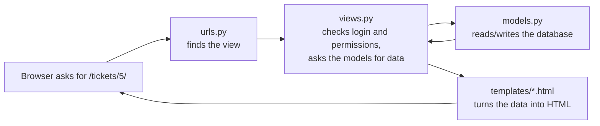
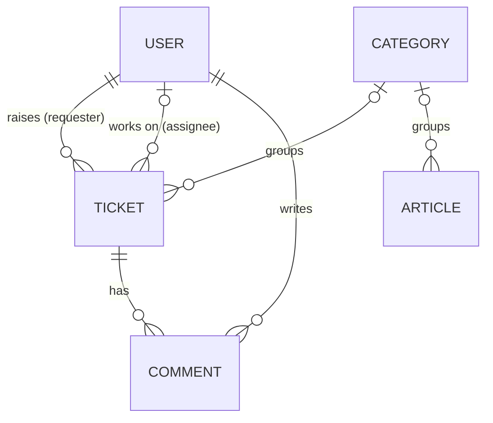

# Helpdesk Ticket Tracker: the guide

This guide explains how the app works, in plain English, for anyone who wants to
understand the code: a new developer, an interviewer, or you before an interview. Read it
top to bottom once, then use it as a reference.

**Contents**

1. [What the app is](#1-what-the-app-is)
2. [Try it in 5 minutes](#2-try-it-in-5-minutes)
3. [How a Django app fits together](#3-how-a-django-app-fits-together)
4. [Tour of the files](#4-tour-of-the-files)
5. [The data: tables and how they link](#5-the-data-tables-and-how-they-link)
6. [How the SLA timers work](#6-how-the-sla-timers-work)
7. [Who can do what](#7-who-can-do-what)
8. [Life of a ticket, step by step](#8-life-of-a-ticket-step-by-step)
9. [The dashboard numbers](#9-the-dashboard-numbers)
10. [Tests and CI](#10-tests-and-ci)
11. [Settings, secrets and security](#11-settings-secrets-and-security)
12. [Common jobs](#12-common-jobs)
13. [Interview talking points](#13-interview-talking-points)
14. [Glossary](#14-glossary)
15. [Roadmap: TechCare Services](#15-roadmap-techcare-services)

---

## 1. What the app is

A service desk web app. People who need IT help **raise tickets**. The IT team **works the
tickets** against time targets (**SLAs**), writes **knowledge-base articles** so people can
fix common problems themselves, and watches a **dashboard** that shows what is late or about
to be late.

There is one website with two kinds of users:

| User | What they see |
|---|---|
| **Requester** (anyone who is not IT staff) | Their own tickets, a "New ticket" form and the knowledge base |
| **IT staff** (`is_staff` ticked) | The dashboard, every ticket, the update panel (status, priority, assignee) and internal notes |
| **Superuser** | All of the above, plus the Django admin at `/admin/` |

The app is being turned into the customer portal of a fictional IT services company,
**TechCare Services**. See [section 15](#15-roadmap-techcare-services).

## 2. Try it in 5 minutes

Set it up once (the README has the same steps):

```bash
cd helpdesk-ticket-tracker
python -m venv .venv
.venv\Scripts\activate              # macOS/Linux: source .venv/bin/activate
pip install -r requirements.txt
copy .env.example .env              # then put a secret key in .env
python manage.py migrate
python manage.py seed_demo          # prints the demo password
python manage.py runserver
```

Open http://127.0.0.1:8000 and follow this script:

1. **Log in as `jordan.lee`** (IT staff). You land on the **dashboard**. Look at
   *SLA breached* and *SLA at risk*, and at the *Needs attention* list.
2. Click **#1 Wi-Fi down for everyone in Building B**. On the right, *First response* is
   **Met** (Jordan replied quickly) but *Resolution* is **Breached** (P1 tickets have 4
   hours). The yellow comment is an **internal note**.
3. In **Update**, set *Status* to **Resolved** and click *Save*. The resolution badge now
   says *Breached* without "overdue by": the clock has stopped, too late.
4. Go to **Tickets**. Try the filters: *Unassigned*, *P1 - Critical*, or search `#3`.
5. **Log out and log in as `sam.taylor`** (a requester). There is no dashboard, and you only
   see Sam's tickets. Open one: the internal note is not there.
6. Click **New ticket**. The page suggests knowledge-base articles. Raise a ticket, then
   look at its SLA badges.
7. Open **Knowledge base** and search `wifi`. It finds the "Wi-Fi" article (hyphens are
   ignored).
8. Try to open a ticket number that belongs to someone else, e.g. `/tickets/2/`.
   You get *Not Found*.

## 3. How a Django app fits together

Django splits a web app into a few kinds of file. Every page in this app goes through the
same path:



| Piece | Job | In this project |
|---|---|---|
| **Settings** | Configuration: database, installed apps, time zone, secret key | `config/settings.py` |
| **URLs** | Map an address to a view | `config/urls.py`, `helpdesk/urls.py` |
| **Views** | Python functions that handle a request and return a page | `helpdesk/views.py` |
| **Models** | Python classes that describe database tables | `helpdesk/models.py` |
| **Migrations** | Files that create or change the tables to match the models | `helpdesk/migrations/` |
| **Forms** | Turn a model into an HTML form and validate what users type | `helpdesk/forms.py` |
| **Templates** | HTML with `{{ placeholders }}` and `` | `helpdesk/templates/` |
| **Admin** | A ready-made back office for editing data | `helpdesk/admin.py` |
| **Management commands** | Your own `python manage.py ...` commands | `helpdesk/management/commands/` |

`config` is the **project** (site-wide settings). `helpdesk` is an **app** (one feature
area). A big site has several apps. This one has one so far.

## 4. Tour of the files

```text
manage.py                 runs Django commands (runserver, migrate, test, seed_demo)
requirements.txt          Python packages to install (Django, python-dotenv)
.env.example              template for your private .env file
pyproject.toml            settings for ruff, the code checker
config/
  settings.py             reads .env; apps, database, time zone, login pages
  urls.py                 /admin/, /accounts/ (login/logout), everything else -> helpdesk
  wsgi.py                 entry point for a production web server
helpdesk/
  sla.py                  the SLA rules (no database code at all)
  models.py               Category, Ticket, Comment, Article
  views.py                one function per page
  urls.py                 the addresses of those pages
  forms.py                new ticket, update ticket, add comment
  permissions.py          @staff_required
  admin.py                how the models appear in /admin/
  templatetags/
    helpdesk_tags.py      , , |person
  templates/
    base.html             header and menu shared by every page
    registration/login.html
    helpdesk/*.html       dashboard, ticket list/detail/form, knowledge base
  static/helpdesk/style.css   the only stylesheet
  management/commands/seed_demo.py   fills the database with demo data
  migrations/0001_initial.py         creates the tables
  tests/                  automatic tests (section 10)
.github/workflows/ci.yml  GitHub runs the checks on every push
docs/                     this guide and the screenshots
```

### The files worth reading first

1. **`helpdesk/sla.py`** is short and has no Django in it, so it's the easiest file to read.
   It holds the business rules.
2. **`helpdesk/models.py`**, especially `Ticket.save()` and `Ticket.add_comment()`.
3. **`helpdesk/views.py`**, especially `ticket_detail` and `ticket_comment`. They show how
   permissions are enforced.
4. **`helpdesk/templates/helpdesk/ticket_detail.html`**, to see how the data reaches the page.

## 5. The data: tables and how they link



**User** is Django's built-in user table. `is_staff` decides whether someone is IT staff.

**Ticket** (the main table):

| Field | Meaning |
|---|---|
| `title`, `description` | What the problem is |
| `requester` | Who raised it. Can't be deleted while they have tickets (`PROTECT`) |
| `assignee` | IT staff member working on it (optional). Only staff can be chosen |
| `category` | Hardware, Printing, ... (optional) |
| `priority` | 1 = P1 Critical, 2 = P2 High, 3 = P3 Medium, 4 = P4 Low |
| `status` | `new`, `in_progress`, `waiting`, `resolved`, `closed` |
| `created_at` | When it was raised. The SLA clocks start here |
| `response_due_at`, `resolution_due_at` | Deadlines, **calculated automatically** (section 6) |
| `first_response_at` | When IT first replied publicly |
| `resolved_at` | When it was resolved. Cleared again if the ticket is reopened |

**Comment** belongs to one ticket. `is_internal = True` makes it an internal note that only
IT staff can see.

**Article** is a knowledge-base page. `is_published = False` keeps it as a hidden draft.
`slug` is the readable address part, e.g. `/kb/reset-your-password/`.

**Category** is a simple list of names shared by tickets and articles.

`TicketQuerySet` in `models.py` adds two shortcuts used everywhere:

- `Ticket.objects.open()`: tickets that are New, In progress or Waiting
- `Ticket.objects.visible_to(user)`: every ticket for IT staff, only their own for anyone else

## 6. How the SLA timers work

An **SLA** (service level agreement) is a promise about how fast IT will act. Each ticket
has two timers, both starting when the ticket is raised:

| Priority | First response within | Resolution within |
|---|---|---|
| P1 - Critical | 30 minutes | 4 hours |
| P2 - High | 1 hour | 8 hours |
| P3 - Medium | 4 hours | 24 hours |
| P4 - Low | 8 hours | 72 hours |

These numbers live in `SLA_TARGETS` in `helpdesk/sla.py`. Change them there and the whole
app follows.

**The four states** (`sla.sla_state()`):

| State | Rule |
|---|---|
| **On track** | Still running, with more than 25% of the time left |
| **At risk** | Still running, with 25% or less left (`AT_RISK_SHARE = 0.25`) |
| **Breached** | Still running and past the deadline, *or* finished after the deadline |
| **Met** | Finished on or before the deadline |

**Worked example.** A P2 ticket is raised at 9:00, so resolution is due at 17:00 (8 hours).

- At 12:00 there are 5 of 8 hours left: **On track**.
- At 15:00 there are 2 hours left, exactly 25%: **At risk**.
- At 17:30 it is still open: **Breached** ("overdue by 30m").
- If it was resolved at 16:00 instead, it shows **Met**, and stays Met forever.

**When the clocks stop:**

- *First response* stops at the first **public** comment by **IT staff** on someone
  else's ticket. Internal notes don't count, and neither does the requester commenting on
  their own ticket. See `Ticket.add_comment()`.
- *Resolution* stops when the status becomes Resolved or Closed (`resolved_at` is set in
  `Ticket.save()`). Reopening the ticket clears `resolved_at`, so the clock runs again.

**Why store the deadlines?** `Ticket.save()` works out `response_due_at` and
`resolution_due_at` every time a ticket is saved. Because they are stored as columns:

- "Which tickets are late?" is a quick database query (`resolution_due_at < now`).
- The ticket list can sort by urgency with plain `ORDER BY resolution_due_at`.
- Changing the priority moves the deadlines. They are still counted from creation time,
  so raising and lowering the priority can't reset the clock.

**Simplifications** (on purpose, listed in the README): the clocks run 24/7 (no business
hours), and they don't pause while waiting on the requester.

## 7. Who can do what

| Action | Not logged in | Requester | IT staff |
|---|---|---|---|
| See the dashboard | login page | **403 Forbidden** | yes |
| List tickets | login page | own tickets only | all, with filters |
| Open a ticket | login page | own only (**404** otherwise) | all |
| Raise a ticket | login page | yes | yes |
| Comment | login page | own tickets only | all |
| Write an internal note | - | no (the checkbox isn't on their form) | yes |
| See internal notes | - | no | yes |
| Change status, priority or assignee | login page | **403** | yes |
| Knowledge base | login page | published articles | published articles |
| Django admin | login page | no | superuser only |

**How it's enforced, and why it's done this way:**

- `@login_required` (from Django) sends anonymous users to the login page.
- `@staff_required` (in `permissions.py`) also sends anonymous users to login, but gives
  logged-in non-staff a **403**. Sending them to the login page would loop, because they
  are already logged in.
- **Data is filtered, not only hidden.** `ticket_detail` and `ticket_comment` both look the
  ticket up through `Ticket.objects.visible_to(request.user)`. Hiding a link in the template
  is not security, because anyone can type a URL. Filtering the database query is.
- **404 instead of 403 for other people's tickets.** A 403 would confirm that ticket #57
  exists. A 404 reveals nothing.
- **Forms only include fields the user may set.** `TicketCreateForm` has no `requester` or
  `status` field, and the view sets `requester = request.user`. Even if someone adds
  `status=closed` to the request by hand, Django ignores it. There's a test for this
  (`test_requester_cannot_choose_the_requester_or_status`).
- Every form has a **CSRF token** (``). It stops other websites submitting
  forms in a logged-in user's name.

## 8. Life of a ticket, step by step

**1. Sam raises a ticket.** The browser posts the form to `/tickets/new/`.

- `helpdesk/urls.py` maps that address to `views.ticket_create`.
- `@login_required` checks that Sam is logged in.
- `TicketCreateForm(request.POST)` validates the title, category, priority and description.
- `form.save(commit=False)` builds the ticket without saving it yet, so the view can set
  `ticket.requester = request.user`.
- `ticket.save()` runs **`Ticket.save()`** in `models.py`, which works out both deadlines
  from the priority.
- The view adds a "Ticket #25 raised" message and redirects to the ticket page.

**2. Jordan replies.** A post to `/tickets/25/comment/` runs `views.ticket_comment`.

- The ticket is fetched with `visible_to(request.user)`. Jordan is staff, so it's found.
- `ticket.add_comment(...)` saves the comment. Because Jordan is staff, the comment is
  public and it's not Jordan's own ticket, it sets `first_response_at`. **The response
  clock stops.**

**3. Jordan asks Sam a question** and sets the status to *Waiting on requester* via
`/tickets/25/update/` (`views.ticket_update`, staff only).

**4. Sam answers.** In `ticket_comment`, a requester replying to a *Waiting* ticket moves it
back to **In progress**, so it shows up in IT's queue again.

**5. Jordan resolves it.** In `Ticket.save()`, status *Resolved* sets `resolved_at = now`
and **the resolution clock stops**. The ticket now shows *Met* or *Breached*.

## 9. The dashboard numbers

All of these are worked out in `views.dashboard`:

| Number | How |
|---|---|
| Open tickets | `Ticket.objects.open()` |
| SLA breached / at risk | Each open ticket's `resolution_sla()` state |
| Unassigned | Open tickets with no `assignee` |
| Awaiting first reply | Open tickets with no `first_response_at` |
| Assigned to me | Open tickets where `assignee` is the logged-in user |
| Last 7 days | Tickets created, and tickets resolved, in the last 7 days |
| SLA compliance | Of tickets resolved in the last 30 days, the share resolved before `resolution_due_at`. Uses `F("resolution_due_at")` so the database compares two columns |
| Needs attention | Breached and at-risk tickets, nearest deadline first, top 10 |

The open tickets are loaded **once** and counted in Python. That's simple and fast for a
helpdesk with hundreds of open tickets. With tens of thousands, these counts would move into
database queries.

## 10. Tests and CI

Run all 42 tests:

```bash
python manage.py test
```

You should see `Ran 42 tests ... OK`. Each test creates its own empty test database, so
your real data is never touched.

| File | What it checks |
|---|---|
| `tests/test_sla.py` | Every SLA rule and boundary (exactly 25% left, exactly at the deadline, ...) and the "2h 15m left" text |
| `tests/test_models.py` | Deadlines on create and on priority change, resolved/reopened, first-response rules, `open()` and `visible_to()` |
| `tests/test_views.py` | Login redirects, 403/404 rules, raising/updating/commenting, internal-note privacy, list filters and order, dashboard counts, knowledge-base search |
| `tests/test_seed_demo.py` | The demo data covers every SLA state, the password option, and refusing to seed twice |
| `tests/helpers.py` | Small functions the tests share (`make_user`, `make_ticket`) |

Run one file or one test while you work on something:

```bash
python manage.py test helpdesk.tests.test_sla
python manage.py test helpdesk.tests.test_views.AccessTests.test_requesters_cannot_open_the_dashboard
```

**Why the tests are fast:** Django's normal password hashing is slow on purpose (it makes
stolen password hashes hard to crack). `settings.py` switches to a fast hasher only while
tests run, which takes the suite from about 2 minutes to under 1 second.

**CI (continuous integration).** `.github/workflows/ci.yml` tells GitHub to do this on
every push:

1. Install Python 3.13 and the requirements.
2. `ruff check` and `ruff format --check`: code style and common mistakes.
3. `manage.py check`: Django's own configuration checks.
4. `makemigrations --check`: fails if someone changed a model but forgot the migration.
5. `manage.py test`: all the tests.

A green badge on the README means every step passed for the latest commit.

## 11. Settings, secrets and security

- **`.env` holds secrets** and is listed in `.gitignore`, so it's never committed.
  `.env.example` shows which variables exist, with no real values.
- **`DJANGO_SECRET_KEY` is required.** The app refuses to start without one, so you can't
  accidentally run with a published key. CI uses a throwaway key that only exists during the
  test run.
- **`DEBUG` is off unless you turn it on.** With debug on, error pages show internal details,
  so it should only be on for your own machine.
- **`TIME_ZONE`** (default Australia/Melbourne) sets how times are displayed. Times are
  stored in UTC (`USE_TZ = True`), so SLA maths is correct even across daylight saving
  changes.
- **Templates escape everything** by default. A ticket titled `<script>` shows as text and
  doesn't run.
- The **demo password** is generated randomly by `seed_demo` and never stored in the code.

Before putting this on the internet you'd also want HTTPS, secure cookies, a real
database (PostgreSQL) and a production web server. That's out of scope for this demo.

## 12. Common jobs

**Create a real admin account:**

```bash
python manage.py createsuperuser
```

**Make someone IT staff:** go to `/admin/`, open *Users*, pick the person, tick
*Staff status* and save.

**Add a category or knowledge-base article:** `/admin/`, then *Categories* or *Articles*,
then *Add*. The slug fills itself in from the title.

**Change an SLA target:** edit `SLA_TARGETS` in `helpdesk/sla.py`. Then update
`tests/test_sla.py` (the test that lists the targets will fail until you do, which is
the point), run the tests and commit. New saves use the new targets.

**Change a model (e.g. add a field):** edit `models.py`, run
`python manage.py makemigrations`, then `python manage.py migrate`, and commit the new file
in `migrations/`.

**Start the demo again from scratch:**

```bash
python manage.py seed_demo --reset
```

## 13. Interview talking points

Questions you may get, with short answers in your own words:

**"Walk me through the project."**
It's a service desk app in Django. Users raise tickets, IT works them against SLA targets
per priority, there's a knowledge base for self-service and a dashboard that shows what's
breached or at risk. It has role-based access, 42 automated tests and CI on GitHub.

**"How do the SLA timers work?"**
Each priority has a first-response and a resolution target. When a ticket is saved, the
model works out both deadlines from the creation time and stores them. A timer is at risk in
its last 25% and breached past the deadline. The first public reply from IT stops the
response clock, and resolving stops the resolution clock.

**"How do you stop a user seeing someone else's ticket?"**
Every lookup goes through a queryset method, `visible_to(user)`, which filters to the user's
own tickets unless they're staff. So it's enforced in the database query, not just hidden in
the page, and they get a 404 so they can't even tell the ticket exists. There are tests for
it.

**"Why store the due dates instead of calculating them?"**
So late tickets are a simple indexed query and the list can sort by deadline. They're
recalculated on every save, so they can't go stale.

**"What would you add next?"**
Business-hours SLAs, pausing the clock while waiting on the customer, email
notifications, organisations for business customers and self sign-up. (The roadmap below
is exactly that.)

**ITIL link:** tickets are *incidents* and *service requests*. Priority, SLA, first response,
resolution, knowledge management and escalation of breached tickets are all ITIL
service-operation ideas.

## 14. Glossary

| Term | Meaning |
|---|---|
| **SLA** | Service level agreement: the promised response and resolution times |
| **Breach** | Missing an SLA deadline |
| **P1 to P4** | Priority levels, P1 being the most urgent (e.g. many people affected) |
| **First response** | The first reply from IT to the person who raised the ticket |
| **Knowledge base (KB)** | Self-help articles. Fewer tickets when people can fix things themselves ("ticket deflection") |
| **Internal note** | A comment only IT staff can see |
| **Queryset** | A Django database query you can keep filtering, e.g. `Ticket.objects.open().filter(priority=1)` |
| **Migration** | A file that changes the database structure to match the models |
| **CSRF** | Cross-site request forgery. Django's token stops other sites submitting forms as you |
| **CI** | Continuous integration: automatic checks on every push (GitHub Actions here) |
| **403 / 404** | "Forbidden" / "Not found" HTTP responses |
| **Seed data** | Fake demo data put into an empty database |

## 15. Roadmap: TechCare Services

The next steps turn this helpdesk into the customer portal of **TechCare Services**, a
fictional IT company that sets up and fixes technology for businesses and for people at
home, on site or remotely. One feature at a time, each with tests and a new section in this
guide:

1. **Organisations and roles.** Business customers get an organisation account. An
   organisation manager sees all of their organisation's tickets. Technicians and admins
   are separate roles.
2. **Company website.** A public home page with services, how it works and prices.
3. **Self sign-up.** Home customers create an account with email, or with
   *Sign in with Google*.
4. **Book a technician visit.** Choose a service, an address and a time slot. Technicians
   see their schedule.
5. **Service charges.** A price list and a quote on every booking. No real payments.
6. **Help assistant.** It answers questions from the knowledge base. If that doesn't help,
   the conversation becomes a ticket or a booking. A real AI model can be plugged in later.
